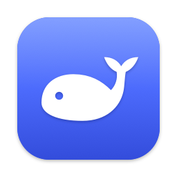

<p align="center">
  
</p>

<h1 align="center">DeepSeek Native</h1>

<p align="center">
  轻量的 macOS 原生 DeepSeek 客户端：在任何应用里按 <b>⌥ Space</b> 就能提问，下载只有 1.5 MB，没有 Electron。
</p>

<p align="center">
  <a href="https://github.com/Lysand-Shen/deepseek-desktop/releases/latest"></a>
  
  
  <a href="LICENSE"></a>
</p>

<p align="center">中文 · <a href="README.en.md">English</a></p>

---

DeepSeek Native 用 SwiftUI + AppKit 搭外壳，用系统自带的 WKWebView 加载官方网页版 [chat.deepseek.com](https://chat.deepseek.com)。聊天、深度思考、联网搜索、上传文件等功能都和网页版完全一致，在此之上补齐了网页做不到的原生体验：像 ChatGPT、Claude 桌面版那样的快速对话框、菜单栏图标、多账户、窗口置顶、关闭后在后台继续运行，以及可随时切换的中英文界面。

- **轻**：只用 Apple 自带框架，没有第三方依赖。应用 3.6 MB，DMG 约 1.5 MB；同时支持 Apple Silicon 和 Intel
- **快**：再次启动时约 0.8 秒就能开始聊天；网页只创建一次，唤出和隐藏是瞬间的
- **省心**：不需要 API Key，不使用 DeepSeek API，也不调用任何未公开接口；用的就是你在浏览器里登录的那个账号

## 下载安装

1. 到 [Releases](https://github.com/Lysand-Shen/deepseek-desktop/releases/latest) 下载 `DeepSeek-x.y.z.dmg`
2. 打开 DMG，把 **DeepSeek** 拖进“应用程序”文件夹
3. 第一次打开时，macOS 会提示“无法验证开发者”。这是因为应用没有经过 Apple 公证（需要付费的开发者账号），任选一种方式放行：
   - 打开“系统设置 › 隐私与安全性”，在页面下方找到 DeepSeek，点按“仍要打开”
   - 或者在终端运行：

     ```bash
     xattr -dr com.apple.quarantine /Applications/DeepSeek.app
     ```

需要 macOS 14 Sonoma 或更高版本。

## 功能

**网页版的完整体验**
- 登录、聊天、历史会话、深度思考、联网搜索、上传图片和文件，都由官方网页提供
- 登录状态和本地存储持久保留，重启后不用重新登录
- 原生文件选择面板；下载默认保存到“下载”文件夹（可改为每次询问）
- 外部链接默认用系统浏览器打开；Google、Apple、微信等第三方登录在应用内的弹窗中完成
- 加载进度条、错误页、断网提示；网络恢复后自动重新加载，网页进程崩溃后自动恢复

**快速对话（⌥ Space）**
- 在任何应用中按 **⌥ Space**，屏幕下方弹出一个胶囊形的小输入框，不会切走当前应用
- 输入问题后按 ↩，输入框像 Gemini 那样向上展开成一个置顶的小对话窗口：回答显示在上方，DeepSeek 的输入框就在原来输入框的位置，可以接着追问；⌥↩ 换行，⎋ 关闭
- 窗口顶部的悬浮按钮：关闭、新对话（收回成输入框），以及在主窗口中打开这段对话；拖动窗口顶部可以移动它
- 再按一次快捷键隐藏
- 可以把图片或文件拖到输入框上：输入框会展开成新对话，文件放进 DeepSeek 的输入框，已经输入的文字也会一起带过去，补充问题后按 ↩ 发送；对话展开后也可以继续往窗口里拖文件
- “设置 › 快捷键 › 打开时显示”可以选择每次按快捷键时显示新对话，还是回到上次离开时的对话；选择“上次的对话”时，点按窗口中的“新对话”按钮可以开始新对话
- 快速对话使用单独的页面，不会打断主窗口里正在进行的对话；对话同样保存在 DeepSeek 的历史记录中
- 可以在“设置 › 快捷键”中录制新的组合，或者停用

**主窗口快捷键**
- 可以另外设置一个全局快捷键，用来显示或隐藏完整的主窗口（默认未设置）
- 唤出位置可选“保持上次位置”或“鼠标所在屏幕居中”；窗口会跟到当前桌面空间，不会切走
- 唤出后自动聚焦输入框；可选“切换到其他应用时自动隐藏”
- 全局快捷键基于 Carbon `RegisterEventHotKey` 实现，不需要辅助功能权限

**原生窗口**
- 工具栏颜色跟随网页背景，浅色、深色模式都无缝衔接；标题栏显示当前会话名
- 界面精简：工具栏只保留重新载入和置顶按钮；收起侧边栏时，隐藏网页左上角的鲸鱼图标
- 记住窗口大小和位置；窗口跑到屏幕外时会自动移回来
- 窗口置顶、全屏、页面缩放
- 关闭窗口后可在后台继续运行，正在生成的回复不会中断
- 外观可选：跟随系统、浅色、深色

**其他**
- 菜单栏图标：点按显示或隐藏窗口，右键点按打开菜单
- 多账户：每个账户使用独立的数据存储，可以同时保持多个账号登录并随时切换
- 登录时自动启动，可隐藏程序坞图标
- 简体中文和英文界面：默认跟随系统，也可以在“设置 › 通用 › 语言”中切换。菜单、设置和对话框立即切换；由 macOS 提供的菜单项和 DeepSeek 网页的默认语言在重新启动应用后切换

## 键盘快捷键

| 快捷键 | 功能 |
| --- | --- |
| ⌥ Space | 快速对话：弹出或隐藏输入框（全局，可自定义） |
| 自定义 | 显示或隐藏主窗口（全局，默认未设置） |
| ⌘ N | 新对话 |
| ⌘ R / ⇧ ⌘ R | 重新载入 / 强制重新载入 |
| ⌘ + / ⌘ − / ⌘ 0 | 放大 / 缩小 / 实际大小 |
| ⌘ [ / ⌘ ] | 后退 / 前进 |
| ⌥ ⌘ T | 窗口置顶 |
| ⌃ ⌘ F | 进入全屏幕 |
| ⌘ 1 | 显示主窗口 |
| ⌘ , | 设置 |
| ⌘ W | 关闭窗口（应用继续在后台运行） |

## 常见问题

**按 ⌥ Space 没有反应？**
很可能有其他应用也用了这个组合，例如 Alfred、Raycast、ChatGPT 桌面版、Claude 桌面版的快速输入。这时可能只有一个应用响应，也可能两个同时响应。请在“设置 › 快捷键”里换一个组合，或者修改另一个应用的快捷键。

**快速对话是怎么把问题发出去的？**
和你自己操作一样：应用在快速对话的小窗口里打开 DeepSeek 网页，把问题填进网页的输入框并按下回车。不使用 API，也不调用任何未公开接口。深度思考和联网搜索沿用你在网页上最后一次的选择。

**怎么把界面换成英文（或中文）？**
打开“设置 › 通用 › 语言”。选“跟随系统”时，系统首选语言是中文就显示中文，否则显示英文。

**我的数据存在哪里？会被上传吗？**
所有登录信息和网页数据都由 WebKit 保存在本机 `~/Library/WebKit/com.sink7.DeepSeekNative`。应用本身不收集任何信息，除了 WebKit 加载 DeepSeek 网页，不会发出其他网络请求。代码完全开源，可以自行检查。

**Google 登录失败？**
是否允许在内嵌浏览器中登录由 Google 决定。应用已使用 Safari 的 User-Agent 以提高兼容性，如果仍被拒绝，可以改用手机号、邮箱或微信登录。

**如何彻底卸载？**
退出应用后删除 `/Applications/DeepSeek.app`，再删除数据和设置：

```bash
rm -rf ~/Library/WebKit/com.sink7.DeepSeekNative ~/Library/Preferences/com.sink7.DeepSeekNative.plist
```

## 从源码构建

需要 Xcode 16 或更高版本（Swift 6）。

```bash
git clone https://github.com/Lysand-Shen/deepseek-desktop.git
cd deepseek-desktop
scripts/build.sh            # Release 构建，产物在 dist/DeepSeek.app
scripts/build.sh --install  # 构建并安装到 /Applications
scripts/build.sh --dmg      # 额外生成 dist/DeepSeek-<版本号>.dmg
```

工程由 [XcodeGen](https://github.com/yonaskolb/XcodeGen) 根据 `project.yml` 生成。生成好的 `DeepSeekNative.xcodeproj` 也一并提交了，没装 XcodeGen 也能直接用 Xcode 打开。

应用图标由 `scripts/make-icons.swift` 根据 DeepSeek 官方标志 `scripts/deepseek-logo.svg` 生成：

```bash
swift scripts/make-icons.swift DeepSeekNative/Resources/Assets.xcassets
```

界面文字在 String Catalog `DeepSeekNative/Resources/Localizable.xcstrings` 中，源语言是英文，另有简体中文翻译。代码里用 `L("…")` 取字符串，切换语言时界面会立即刷新。添加新语言：在 Xcode 中打开这个文件添加语言，再把语言代码加入 `Localizer.swift` 的 `AppLanguage` 和 `Info.plist` 的 `CFBundleLocalizations`。

> 构建产物放在 `~/Library/Developer/Xcode/DerivedData/DeepSeekNative`。如果项目位于 iCloud 同步的“文稿”文件夹，系统会给 .app 加上 Finder 元数据，直接在项目目录内签名会失败，所以构建放在了同步目录之外。

### 代码结构

```
DeepSeekNative/
  App/          main.swift、AppDelegate（生命周期、菜单动作、唤出逻辑）、MainMenu
  Settings/     AppSettings（UserDefaults 持久化）、ProfileStore（多账户）、LaunchAtLogin、
                Localizer（界面语言与运行时切换）
  HotKey/       KeyCombo、HotKeyManager（Carbon 全局快捷键）
  QuickChat/    QuickChatController、QuickEntryPanel（输入框）、QuickChatPanel（小窗口）、
                QuickChatSession（小窗口自己的网页）
  Web/          WebViewModel（WKWebView 与状态）、WebViewDelegate、LinkPolicy（链接分流）、
                DownloadManager、WebDialogs、NetworkMonitor、WebScripts
  Window/       MainWindowController（窗口与工具栏）、PopupWindowController、StatusItemController
  Views/        MainContentView（网页与加载、错误、断网提示）、Settings/*
```

- 状态类均为 `@MainActor @Observable`，开启 Swift 6 严格并发检查，编译零警告
- 窗口、菜单、菜单栏图标用 AppKit 管理（窗口需要隐藏、唤出、跨桌面空间移动），内容和设置页用 SwiftUI
- WKWebView 只创建一次；关闭窗口只是隐藏，不会销毁页面

### 调试

```bash
defaults write com.sink7.DeepSeekNative WebInspectorEnabled -bool true   # Release 版开启 Safari 网页检查器
log stream --level info --predicate 'subsystem == "com.sink7.DeepSeekNative"'
```

## 已知限制

- 应用使用 ad-hoc 签名，没有经过 Apple 公证，第一次打开需要手动放行（见“下载安装”）
- 没有开启 App Sandbox：ad-hoc 签名下，每次重新构建都会触发沙盒容器的权限提示。已启用 Hardened Runtime，网页内容运行在 WebKit 自己的沙盒进程中
- 菜单中的“新对话”（⌘N）会点击网页自带的“开启新对话”按钮，找不到时退回为重新载入首页
- 收起侧边栏时隐藏的鲸鱼图标，是按 DeepSeek 样式表里的类名识别的。这些类名由构建工具生成，DeepSeek 更新网页后可能会变，那时图标会重新出现，不影响使用
- 快速对话把问题填进网页的输入框并按回车发送。如果 DeepSeek 改版导致发送失败，问题会留在小窗口的输入框里，可以手动发送；需要时更新 `WebScripts.swift`
- 快速对话的小窗口在隐藏 10 分钟后释放网页进程以节省内存，之后第一次提问会多等一两秒
- 快速对话窗口隐藏了 DeepSeek 窄版页面自带的顶部栏（按类名 `the-header` 识别）。如果 DeepSeek 改了类名，顶部栏会重新出现，不影响使用

## 免责声明

本项目是非官方的第三方客户端，与杭州深度求索人工智能基础技术研究有限公司（DeepSeek）没有关联，也未获得其认可。“DeepSeek”名称和鲸鱼标志归其所有者所有，本项目仅用它们表明应用加载的是哪个服务，它们不在本项目的 MIT 许可范围内。聊天服务由 DeepSeek 提供，使用时请遵守 DeepSeek 的用户协议。

## 许可

代码以 [MIT](LICENSE) 许可开源。
